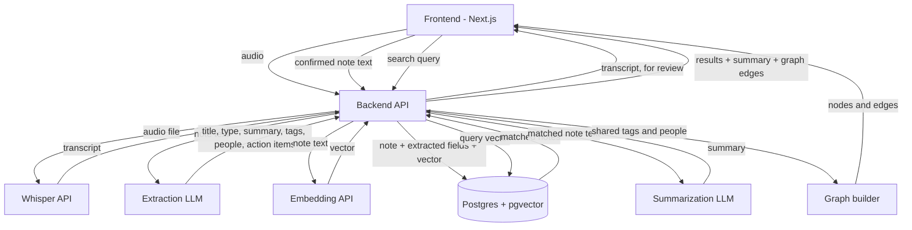

# Semantic Note-Taking App — Development Plan

_Sep 25, 2026_

## Overview

A note-taking app for 1-2 hardcoded users, built on three pillars: flexible capture (typed, or spoken via Whisper), an LLM extraction step that turns every note into a structured record (title, type, summary, tags, people, action items), and a connections graph that links notes sharing a tag or person, shown as a force-directed map.

Core idea: saving a note triggers two AI calls - an extraction call (title, type, summary, tags, people, action items) and an embedding call (for search only). The map is not an embedding projection; it is a graph where notes become nodes and edges form when two notes share a tag or a person, laid out with a physics-based simulation (d3-force). Search embeds the query and finds nearby vectors, then an LLM summarizes the matched notes and highlights them in both the list and the graph.

All AI calls (extraction, embeddings, Whisper transcription, summarization) use hosted APIs, called from the backend only - never directly from the browser.

## Architecture

One backend service owns all external calls (Whisper, extraction, embeddings, summarization) and all database access. The frontend never calls external AI APIs directly - keeps API keys server-side and lets the backend control cost, retries, and rate limits. The connections graph is computed from shared tags/people on each request rather than stored - cheap to compute, and always reflects the current note set.

## Tech stack

| Layer | Choice | Why |
| --- | --- | --- |
| Frontend | Next.js (React) + Tailwind | Fast to build, good defaults, easy deploy to Vercel |
| Map visualization | D3.js (d3-force) | Force-directed graph layout - the prototype's existing approach, reused directly |
| Backend | Node.js (Express/Fastify) or Python (FastAPI) | Either works well now - no heavy ML/vector tooling required since the map is tag-based, not an embedding projection |
| Database | PostgreSQL + pgvector extension | Vector search for the search feature, plus relational storage for notes and their extracted fields |
| Vector index | HNSW (via pgvector) | Better recall/speed tradeoff than IVFFlat at this scale |
| Extraction model | Claude Haiku or GPT-4o-mini | Cheap, fast structured-output call: title, type, summary, tags, people, action items |
| Embeddings | OpenAI text-embedding-3-small | Cheap, 1536 dims, powers search only - not the map |
| Transcription | OpenAI Whisper API | Hosted, consistent quality, record-then-upload flow |
| Summarization | Claude Haiku or GPT-4o-mini | Same model family as extraction works fine for search-time RAG summaries |
| Auth | Custom email + password, sessions via httpOnly JWT cookie | No public signup needed; simplest reliable option for 1-2 users |
| Hosting (backend) | Render, Fly.io, or Railway | Simple deploy |
| Hosting (frontend) | Vercel | Native Next.js support |
| Hosting (database) | Supabase or a managed Postgres with pgvector enabled | Managed Postgres with pgvector pre-available saves setup time |

Alternative worth naming: Supabase alone can cover Postgres + pgvector + auth + storage in one service, which would remove the need for a separate auth implementation. Worth deciding early since it changes the auth section below.

## Data model

Three tables cover the whole flow - one fewer than before. Extraction fields (title, type, summary, tags, people, action items) live directly on `notes`, since the extraction call produces all of them together in one step. There is no map-position table: the connections graph is computed live from `tags`/`people` overlap on each request, not pre-projected and stored.

| Table | Key columns | Purpose |
| --- | --- | --- |
| `users` | id, email, password\_hash, created\_at | Manually provisioned accounts, no signup flow |
| `notes` | id, user\_id (FK), raw\_text, title, type, summary, tags (text array), people (text array), action\_items (text array), source (typed / voice), created\_at, updated\_at | The note plus everything the extraction step produces |
| `note_embeddings` | note\_id (FK, 1:1), embedding vector(1536), model\_version | The semantic vector per note, used only for search |

`model_version` still matters: if the embedding model changes later, old rows can be identified and re-embedded rather than silently mixed with new ones. `type` is set automatically by extraction but should stay user-editable - the prototype lets you override it from a dropdown - and that is a plain field update, no re-extraction needed.

## Embeddings flow

Embeddings are generated once, at note-save time, and stored alongside the note. This vector is used only for search - the connections map is built separately, from shared tags and people.

1. User saves a note (typed, or transcribed from voice).
2. Backend sends the note's text to the embedding API (OpenAI text-embedding-3-small).
3. API returns a 1536-number vector representing the note's meaning.
4. Backend writes the note to `notes` and the vector to `note_embeddings` in the same transaction.
5. If the note is later edited, re-run steps 2-4 for that note only; deleting a note cascades to delete its embedding row.

Generation timing: synchronous (inline with the save request) is simplest and adds roughly 200-500ms of latency - acceptable at this scale. No background job queue needed for v1.

## Search flow

Semantic search is the primary mechanism, with keyword search as a supplementary signal for exact-term precision.

1. User types a query (e.g. "fruit").
2. Backend sends the query text to the same embedding API, gets a query vector.
3. Backend runs a pgvector similarity query (cosine distance, HNSW index) against `note_embeddings`, scoped to the logged-in user, returning the top N nearest notes.
4. In parallel, backend runs a Postgres full-text search (`tsvector`) for exact keyword matches.
5. Results from both are merged and ranked (reciprocal rank fusion is a simple, effective method) so exact matches and semantic matches both surface appropriately.
6. Ranked note list is returned to the frontend, along with the note IDs, which are also used to highlight the corresponding points on the map.

This hybrid step is what protects against ambiguous terms ("Apple" the company vs "apple" the fruit) - the embedding alone usually resolves this from context, and keyword matching acts as a backstop for precision cases.

## Summarization / RAG flow

Retrieval narrows the note set first; summarization then explains that narrowed set in plain language. This keeps LLM calls cheap and fast, since only a handful of notes are ever sent to the summarization model, not the full note history.

1. Run the search flow above to get the top N matched notes (retrieval).
2. Send those matched notes' actual text, plus the original query, to the summarization LLM with a prompt like: "Here are notes the user wrote: \[...\]. They searched for '\<query>'. Summarize what they've noted about this."
3. LLM returns a short natural-language summary (e.g. "You've noted a Samsung phone, an Apple device, and a mention of Xiaomi").
4. Summary is returned to the frontend alongside the ranked note list, shown above or beside the results.
5. Optional: cache the summary per (user, query) pair for a short period, to avoid re-summarizing on repeated identical searches.

This only runs at search time, on demand - it is not pre-computed or stored permanently against the notes themselves.

## Map visualization flow

The map is a connections graph, not an embedding projection. Two notes link only when they share a tag or a mentioned person - clustering happens because related notes get related tags from extraction, not because of vector distance.

Build steps:

1. On save, the extraction step already produces each note's `tags` and `people` arrays - no extra processing needed to prepare for the graph.
2. When the map is requested, build a graph in memory: one node per note, one edge between any two notes that share at least one tag or person, weighted by how many they share.
3. Node size reflects degree (how many notes it connects to) - matches the prototype's existing behavior.
4. Lay the graph out client-side with a force simulation (d3-force: link, charge, collision, center forces) - the prototype's existing `drawMap()` logic can largely be reused as-is.
5. Clicking a node shows its title, summary, and what it connects to and via which shared tag or person; hovering highlights just that node's neighborhood.

Live behavior: since the graph is computed fresh from current tags/people rather than pre-computed positions, a new note's connections appear immediately after it saves - no incremental-transform or refit problem the way an embedding projection would have. The backend can return the full node/edge list on every request (fine at this note-count scale), or the frontend can keep its own copy and add one node when a save returns.

## Auth flow

No public signup. Accounts are provisioned manually, directly in the database.

1. New user needed: insert a row into `users` with a hashed password (bcrypt or argon2), created via a one-off admin script or direct DB insert - never through an exposed API route.
2. Login: user submits email + password on a login form. Backend verifies the hash, issues a session as an httpOnly JWT cookie.
3. Every request to notes, search, and map endpoints reads the user ID from that session and scopes all database queries to it - this scoping is built in from the first endpoint, not retrofitted later.
4. No forgot-password flow needed initially; a password reset can be done directly in the database by whoever provisions accounts.

Note: if Supabase is chosen for hosting (see Tech stack), its built-in auth can replace this custom flow - decide this before implementation starts, since it changes both backend and frontend auth code.

## API endpoints

| Method + path | Purpose |
| --- | --- |
| POST /auth/login | Verify credentials, issue session cookie |
| POST /auth/logout | Clear session |
| POST /notes | Save a note: run extraction (title, type, summary, tags, people, action items) and embedding, store both, return the saved note |
| POST /notes/transcribe | Accept a recorded audio file, return transcribed text via Whisper - does not save, lets the user review/edit before save |
| GET /notes | List all notes for the logged-in user |
| PUT /notes/:id | Edit a note: re-run extraction and re-embed |
| DELETE /notes/:id | Delete a note and its embedding row |
| GET /search?q= | Run hybrid search, return ranked notes + RAG summary + matched note IDs for map highlighting |
| GET /map | Return nodes (notes) and edges (shared tag/person connections) for the graph view |

All routes except /auth/login require a valid session and are scoped to the authenticated user's data.

## Environment setup and configuration

**Services needed before coding starts:**

- PostgreSQL instance with the `pgvector` extension enabled (Supabase, or any managed Postgres that supports it, or local via Docker for dev)
- OpenAI API account and key (embeddings, transcription, summarization)

**Backend environment variables:**

| Variable | Purpose |
| --- | --- |
| DATABASE\_URL | Postgres connection string |
| OPENAI\_API\_KEY | Used for embeddings, Whisper, and summarization calls |
| JWT\_SECRET | Signs session cookies |
| EMBEDDING\_MODEL | e.g. text-embedding-3-small - kept configurable in case of future model changes |
| SUMMARIZATION\_MODEL | e.g. gpt-4o-mini |
| EXTRACTION\_MODEL | e.g. claude-haiku - used for the note extraction call (title, type, summary, tags, people, action items) |

**Local dev setup order:**

1. Run Postgres locally (Docker) with pgvector enabled, or point to a hosted dev instance.
2. Run the DB migration to create the three tables (users, notes, note\_embeddings) plus the HNSW index on the embedding column.
3. Manually insert the one or two hardcoded user rows (hashed passwords).
4. Set backend env vars, start the FastAPI server.
5. Set frontend env var for the backend API base URL, start the Next.js dev server.

## Development phases

Build in this order - each phase produces something testable before the next begins.

| Phase | Delivers |
| --- | --- |
| 1. Skeleton | DB schema, backend running, login flow working, empty frontend shell |
| 2. Text notes, no AI | Save/list/edit/delete typed notes, plain list view, no extraction or embeddings yet |
| 3. Extraction + embeddings | Save triggers extraction (title, type, summary, tags, people, action items) and embedding; entries show structured fields |
| 4. Semantic search | Hybrid search endpoint using the embeddings from phase 3, results list in frontend |
| 5. Voice input | Audio capture in frontend, Whisper transcription endpoint, review-before-save step |
| 6. Map view | Graph builder (shared tags/people), GET /map endpoint, d3-force scatter reusing the prototype's layout logic |
| 7. RAG summarization | Summarization endpoint wired into search, summary shown with results |
| 8. Polish | Map highlighting on search, error handling, loading states, basic styling pass |

Phase 3 (extraction + embeddings) is the highest-risk piece now - the map itself (phase 6) is comparatively low-risk since it reuses the prototype's working d3-force graph almost as-is.

## To-do checklist

**Setup**

- [ ] Provision Postgres with pgvector enabled
- [ ] Get OpenAI API key, set usage limits
- [ ] Scaffold FastAPI backend project
- [ ] Scaffold Next.js frontend project
- [ ] Write DB migration for all three tables + HNSW index

**Auth**

- [ ] Write admin script to manually insert a user (hash password)
- [ ] Build login endpoint + session cookie issuance
- [ ] Build login page (frontend)
- [ ] Add auth middleware scoping all data routes to the session user

**Notes CRUD**

- [ ] POST /notes (save, triggers embedding)
- [ ] GET /notes (list)
- [ ] PUT /notes/:id (edit, re-embed)
- [ ] DELETE /notes/:id (cascade delete embedding row)
- [ ] Frontend input box with save button
- [ ] Extraction call helper (title, type, summary, tags, people, action items) run on save and edit
- [ ] Type override control (dropdown) so the user can correct the auto-assigned type

**Voice input**

- [ ] POST /notes/transcribe endpoint calling Whisper API
- [ ] Frontend mic capture + audio upload
- [ ] Review/edit-before-save UI step

**Semantic search**

- [ ] Embedding generation helper (shared by save and search)
- [ ] pgvector similarity query with HNSW index
- [ ] Postgres full-text search query
- [ ] Merge/rank both result sets (reciprocal rank fusion)
- [ ] GET /search endpoint
- [ ] Frontend search bar + results list

**Map**

- [ ] Graph-builder function: edge between any two notes sharing a tag or person, weighted by count
- [ ] GET /map endpoint returning nodes + edges
- [ ] Frontend force-directed layout (d3-force) - adapt the prototype's existing drawMap logic
- [ ] Node click -> detail panel with title, summary, and connections list
- [ ] Highlight matched notes on map after a search

**RAG summarization**

- [ ] Summarization prompt template
- [ ] Wire summarization into /search response
- [ ] Frontend display of summary above/beside results

**Polish**

- [ ] Error handling and loading states across all API calls
- [ ] Basic responsive styling
- [ ] Manual end-to-end test pass across all phases above

## Open questions

- [ ] Supabase (bundled Postgres + pgvector + auth) vs separate custom-built pieces - decide before Phase 1, since it changes the auth implementation.
- [ ] Extraction/summarization model vendor: the prototype calls Anthropic directly - keep that, switch to OpenAI to match the embeddings/Whisper vendor, or mix both is fine either way - just confirm the choice before Phase 3.
- [ ] Retention/versioning: keep old embeddings when a note is edited, or overwrite in place?
- [ ] Note types: keep the prototype's fixed set (idea, task, note, person, link, expense, journal), or adjust the list for your actual use case before Phase 3?